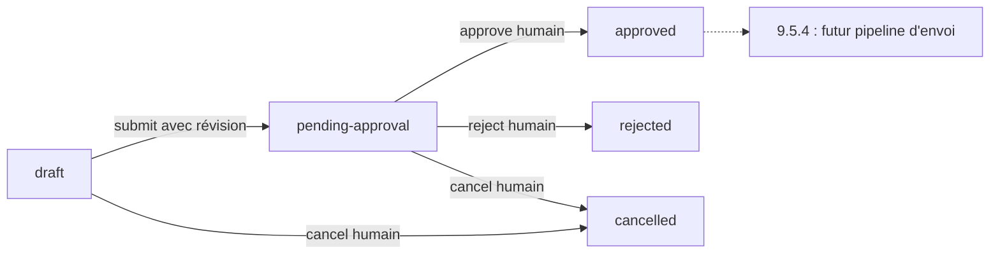

# Phase 9.5.3 — Préparation email et approbation humaine persistante

## Référence et périmètre

Travail local du 16 octobre 2026 sur `main`, depuis
`cb1f10c1b8594c77d47965adaf314d52f640c0d7` (`Validate inbound email sync through n8n`).
HEAD, origin/main et la référence distante étaient identiques ; arbre propre et
index vide. [Build #66](https://github.com/HellzDraft/ProspectionCrm/actions/runs/38897030216)
est `completed / success` sur ce SHA.

Clôture locale le **21 octobre 2026**, après reprise de l'interruption Codex :
la seconde suite globale avait terminé le 16 octobre avec **1 595/1 595 tests
réussis, 0 échec et 0 ignoré**. Son journal et son TRX complets sont disponibles ;
aucune relance ni reconstruction n'a été nécessaire. Les **45/45 fichiers source**
correspondent aux empreintes SHA-256 enregistrées au lancement de cette passe.
Seul le présent rapport est modifié pendant la reprise.

Les modèles, services, worker/executor et documents Phase 8.5/8.6, ainsi que les
comptes, imports, contrats et intégrations 9.5.1/9.5.2, ont été relus. Le catalogue
avait une seule action, `create-crm-task`. L'extension ajoute `email.send` dans la
catégorie `email`, exclusivement comme **préparation à faire approuver**.

Aucun envoi, transport sortant, n8n, fournisseur, OAuth, SMTP, callback fournisseur
ou identifiant de message fournisseur n'est implémenté ou appelé. Aucune phase
9.5.4 n'est exécutée. Aucun staging, commit ou push pendant cette validation.

## Architecture en deux temps

`EmailSendPlan` représente une intention humaine ou une préparation issue d'une
`AutomationRule`. Ce n'est jamais un `EmailMessage`. La décision reste dans
`AutomationActionRequest`, avec les routes approve/reject existantes.



`approved`, `rejected` et `cancelled` sont terminaux dans cette tranche. Aucun état
`sending` ou `sent`. La stratégie d'immutabilité **A** est retenue : un PUT n'est
possible qu'en draft. Une correction après soumission exige un nouveau plan,
avec un nouvel identifiant et une nouvelle demande. Aucun retour implicite en draft.

Le plan conserve compte, connexion, From, destinataires, sujet, corps, références
CRM explicites, hash, révision, révision soumise, identifiant de demande et dates
de création/soumission/décision. Le draft est lisible avant soumission ; aucune
demande ni intention d'intégration n'existe encore à ce stade.

## Snapshot et fingerprint

`ActionPlanJson` contient un `EmailSendSnapshot` fermé, version 1, avec exactement
14 propriétés : version, planId, workspaceId, emailAccountId, connectionId,
revision, fromAddress, toAddresses, ccAddresses, subject, bodyText, opportunityId,
companyId, contactId. Le parseur refuse versions inconnues, propriétés inconnues
ou dupliquées, propriétés manquantes, GUID vides et contenus non valides.

SHA-256 porte sur la sérialisation canonique de tous ces champs, y compris l'ID
du plan et sa révision de contenu. `EmailSendPlan.ContentHash` et
`AutomationActionRequest.ContentFingerprint` doivent concorder. La révision
soumise reste figée ; les révisions suivantes décrivent seulement les transitions.
Les To/Cc sont triés avec comparaison ordinale et dédupliqués ; une adresse déjà
dans To est retirée de Cc. Le corps et le sujet ne sont pas réécrits.

À l'approbation, le service reparse la demande, recalcule le hash du plan courant,
compare les deux snapshots entiers, revérifie le compte et les références CRM.
Pour une origine automation, il revérifie aussi la règle active/non archivée et
son `RuleFingerprint` Phase 8. Pour une demande manuelle, ce champ historique
contient le hash de contenu ; le champ dédié ContentFingerprint reste l'autorité
de comparaison du contenu dans les deux origines.

Un trigger PostgreSQL empêche de modifier le contenu ou le lien de demande d'un
plan déjà soumis et empêche les transitions depuis un état terminal. Le service
ne dépend pas de ce seul garde-fou : une demande dont le snapshot diverge est
refusée à l'approbation. Le rejet reste possible pour fermer une demande obsolète.

## Relation avec la Phase 8

AutomationJobId et AutomationRuleId deviennent nullables ensemble sur les demandes.
Les deux ne peuvent être nuls que pour `email.send`. Aucune règle ou aucun job
fictif n'est créé pour une préparation humaine. Les demandes Phase 8 existantes
gardent leurs identifiants et comportements.

Les FK restent Restrict. Un plan référence une demande du même workspace ; son
index unique sur AutomationActionRequestId empêche de partager une approbation
entre plusieurs plans. La demande automation conserve l'unicité par job.

L'ancienne clé alternative incluant job/règle devient un index unique nullable,
car EF impose NOT NULL aux colonnes d'une clé alternative. La FK EF des executions
utilise workspace/demande, et la migration ajoute **en plus** la FK PostgreSQL
à quatre colonnes `FK_Executions_RequestOrigin953` vers l'index unique. La garantie
Phase 8 interdisant de relier une execution à la demande d'un autre job/règle est
ainsi conservée en base. La clé alternative workspace/Id sert aux liens généraux.

Les DTO existants gardent `ActionPlan` pour les tâches et ajoutent `EmailPlan` typé
et `ContentFingerprint`. Les identifiants job/règle peuvent être null. Les GET et
la supervision partagent IsStale adapté aux demandes manuelles email ; aucun JSON
brut corrompu n'est renvoyé comme snapshot valide.

## Policy et automation

`AutomationSafetyPolicy` reste inchangée : email + automatic demandé donne assist
et approval-required. manual conserve une décision manual explicite, assist une
décision approval-required. Aucun email ne reçoit une autorisation automatique.

Les drafts humains sont préparables sans activer l'automatisation. Leur **soumission**
consulte les settings persistants du workspace et la même policy : settings absents
ou IsEnabled=false bloquent la soumission. Une décision sur une demande déjà pending
reste possible lorsque le kill switch est désactivé, comme en Phase 8 ; elle n'exécute rien.

Une règle email contient un `EmailSendContent` fermé dans ActionConfigurationJson,
sous la limite de définition Phase 8. Compte, destinataires, contenu et références
sont explicites ; rien n'est déduit du contact ni du contexte d'événement. Le moteur
évalue les conditions et la policy, puis prépare le même EmailSendPlan et sa demande
dans la transaction de mise en attente. Le lease est revérifié avant de le libérer.

Le job devient awaiting-approval. Comme l'attente Phase 8.5, cette préparation ne
crée aucune AutomationExecution : aucun faux succès, EffectApplied ou compteur
d'effet. Approve termine le **job de préparation** en completed ; reject/cancel le
termine en cancelled. Il n'est jamais remis pending pour un exécuteur email.
L'autorisation future appartient au plan approved. L'exécuteur create-crm-task
reste le seul exécuteur d'effet et son contrat reste typé tâche.

## Comptes, références et limites

- Compte du même workspace, active, non archivé, non revoked ; connexion identique
  à la connexion logique configurée. Aucun secret ou OAuth dans le plan.
- From est exactement EmailAccount.EmailAddress. Si l'adresse change en draft,
  submit refuse ; un PUT explicite du draft rafraîchit From. Après soumission,
  l'ancienne adresse reste figée et approve refuse toute incompatibilité courante.
- OpportunityId, CompanyId et ContactId sont facultatifs et explicites ; FK
  composites et lectures sous verrou imposent le workspace. To ne dépend jamais
  de Contact.Email. Aucune création automatique d'entité CRM.
- To obligatoire et non vide, Cc facultatif ; 100 destinataires combinés maximum
  avant déduplication. Règles d'adresse et normalisation réutilisées d'email.sync.
  Adresses seules, sans espaces/contrôles, display names ou injection CR/LF.
- Subject nullable ou vide autorisé, 1 000 caractères maximum, aucun contrôle.
- BodyText obligatoire, vide autorisé, texte uniquement, 32 000 caractères maximum.
  CR/LF/tabulation sont permis dans le corps ; autres contrôles, NUL et balisage HTML
  sont refusés. Aucun champ HTML, Bcc ou pièce jointe.
- Budget supplémentaire de sérialisation : contenu 59 000 octets, snapshot 60 000,
  stockage de demande 65 536. Les caractères échappés comptent ; un contenu peut
  atteindre le budget d'octets avant la limite de caractères.

## API humaine

| Route | Résultat |
| --- | --- |
| POST /api/email-send-plans | 201, draft depuis EmailSendContent |
| GET /api/email-send-plans | Liste, offset ≥ 0, limit 1–200, défaut 50 |
| GET /api/email-send-plans/{id} | Détail ; 404 pour absent/étranger |
| PUT /api/email-send-plans/{id} | `{ revision, content }`, draft seulement |
| POST /api/email-send-plans/{id}/submit | `{ revision }`, crée une seule demande |
| POST /api/email-send-plans/{id}/cancel | `{ revision }`, draft ou pending seulement |
| POST /api/automation-action-requests/{id}/approve | Décision + plan approved atomiques |
| POST /api/automation-action-requests/{id}/reject | Décision + plan rejected atomiques |

Le workspace vient de la session. Cookie humain et antiforgery restent obligatoires ;
HMAC seul n'autorise aucune route humaine. Les DTO refusent les champs inconnus ;
les révisions sont obligatoires. Corps des routes de plan bornés à 65 536 octets.
Aucun endpoint `/send`. Les erreurs contrôlées et logs n'incluent pas les corps,
destinataires, snapshots ou détails SQL ; le filtre ne journalise que le type d'erreur.

## Transactions, idempotence et concurrence

Toutes les mutations utilisent un verrou de workspace et le verrou transactionnel
d'automatisation Phase 8. La décision prend demande puis plan, puis revalide compte
et références ; aucun réseau dans la transaction. Annulation pending suit le même
ordre demande/plan. Update/submit sont sérialisés et contrôlent la révision attendue.

- Double submit : conflit contrôlé 409, sans deuxième demande.
- Double approve/reject identique : 200 idempotent, mêmes dates/note, aucun nouvel effet.
- Décision opposée après décision : 409.
- Approve/reject ou cancel/approve concurrents : un gagnant ; les deux lignes restent cohérentes.
- Update/submit concurrents sur la même révision : un gagnant ; submit ne peut
  approuver implicitement le contenu de la révision suivante.
- Compte devenu indisponible : 409 à approve, demande et plan restent pending.
- Plan approuvé : ni PUT ni cancel ne peut le modifier silencieusement.

## Migration et Development

Migration additive : **20261016123347_Phase953EmailSendPlans**. Nouvelle table vide,
colonne ContentFingerprint nullable sur les anciennes demandes, origines optionnelles,
FK/index/contraintes et trigger d'immutabilité. Aucun fichier de migration historique
réécrit, aucune donnée existante transformée. Le snapshot EF est régénéré.

Les tests migrent exclusivement des PostgreSQL Testcontainers jetables : base vierge,
upgrade depuis 9.5.1, comparaison de toutes les lignes historiques, Down/Up avec le
nouveau périmètre vide et refus transactionnel de Down si un plan/demande email existe.
Ce refus évite de perdre une autorisation ; il faut une décision explicite sur ces
données avant un downgrade. Aucun reset de décisions ni faux identifiant de job.

**Aucune migration Development exécutée pendant 9.5.3 ni pendant la reprise.**
La dernière migration connue et confirmée avant interruption est
`20261016093720_Phase951InboundEmailSync`. Lors de la clôture du 21 octobre,
Docker est arrêté et son moteur Linux inaccessible ; aucune nouvelle lecture SQL
de Development n'est donc effectuée. Cet état reste inchangé : aucun démarrage
ou redémarrage de Docker, n8n, API, Blazor ou proxy. Les ports locaux
5432/5678/5016/5054/7075/7096/7443 n'ont aucun listener lors du contrôle.
Les données de preuve 9.5.2 et les secrets restent hors périmètre.

## Validation locale et historique

| Contrôle | Résultat |
| --- | --- |
| Build Release | **0 erreur, 0 avertissement** |
| Tests dédiés 9.5.3 | **44/44**, 0 échec, 0 ignoré |
| Régressions Phase 8 / inbound / intégration / migrations | **882/882**, 0 échec, 0 ignoré (7 min 9 s) |
| Reconstruction Phase 6 après correction de l'attente de migration | **1/1**, 0 échec, 0 ignoré |
| Suite globale finale (`global-02`) | **1 595/1 595**, 0 échec, 0 ignoré (27 min 49 s dans le journal) |
| HasPendingModelChanges | **false**, commande EF et tests de migration ; tests également verts dans `global-02` |
| Empreintes source au lancement de `global-02` | **45/45 identiques**, aucun fichier manquant ou supplémentaire dans le périmètre source |
| git diff --check | **Réussi**, code de sortie 0 à la clôture |
| Index Git | **Vide**, 0 fichier indexé |
| HEAD et origin/main | `cb1f10c1b8594c77d47965adaf314d52f640c0d7` sur `main` |

Les 44 cas dédiés sont répartis ainsi :

| Classe | Cas | Couverture |
| --- | ---: | --- |
| EmailSendPlanTests | 17 | Cycle de vie, snapshots, compte, policy persistante, absence d'effets |
| EmailSendPlanSecurityTests | 15 | Authentification humaine, CSRF, workspace, références, DTO et limites |
| EmailSendPlanConcurrencyTests | 4 | Décisions concurrentes et update/submit sur la même révision |
| EmailSendPlanAutomationTests | 6 | Worker réel local, modes manual/assist/automatic et absence d'exécuteur email |
| EmailSendPlanMigrationTests | 2 | Upgrade 9.5.1, préservation, base vierge, Down/Up et garde de downgrade |

La sélection dédiée utilise `FullyQualifiedName~EmailSendPlan`. La régression
utilise `FullyQualifiedName~Automation|FullyQualifiedName~EmailSync|FullyQualifiedName~EmailAccount|FullyQualifiedName~Integration|FullyQualifiedName~RemoteCollection|FullyQualifiedName~Migration`.
La suite globale utilise `dotnet test ProspectionCrm.slnx --configuration Release --no-build`.
Les tests sont exécutés en Release, avec TRX dans le répertoire privé ci-dessous.

Historique conservé hors Git : premier build réussi avec les deux CS8618 préexistants
de Settings.razor ; build-02 rouge sur deux littéraux SQL bruts interpolés de tests
(CS9006/CS1733), corrigés ; build-03 réussi avec EF1003 sur la requête de comparaison
des tables. Les noms sont issus des métadonnées PostgreSQL et échappés ; le warning
est supprimé localement avec justification. Build-04 réussi avant les 44 tests verts.
Les 44 tests dédiés sont verts dès la première passe. Journaux et TRX restent
hors Git, dans `%LOCALAPPDATA%\ProspectionCrmOperations\phase-9-5-3-email-approval-20261016`.

La commande EF `migrations has-pending-model-changes --configuration Release --no-build`
confirme également l'absence de changement de modèle. Elle signale seulement que
les outils EF 10.0.10 sont antérieurs au runtime 10.0.12 ; aucune mise à jour
d'outil ni migration Development n'est exécutée.

La revue des 46 fichiers ne détecte aucun secret réel connu, jeton ou clé privée,
ni artefact local. Aucun appsettings, export n8n, log, TRX, dump, certificat,
profil navigateur ou contenu bin/obj ne fait partie du périmètre. Les corps de
messages des tests sont synthétiques et les adresses utilisent `example.invalid`.

La première passe de régression termine à **878/882**, avec **4 échecs et 0 ignoré**. Elle a détecté quatre tests historiques à adapter :
les listes des tables antérieures aux jobs et à la planification ne doivent pas inclure la nouvelle
table vide ; un downgrade refusé en 9.4 laisse maintenant deux migrations ultérieures
en attente ; la comparaison 8.5/8.6 doit ignorer la nouvelle colonne nullable
ContentFingerprint. Les snapshots ordinaires conservent cette colonne : son exclusion
est explicite et limitée à la comparaison d'anciens schémas. Aucun contrôle de
préservation des anciennes valeurs n'est retiré.

La deuxième passe (`regressions-final`) termine à **881/882**, avec **1 échec et
0 ignoré** : après la comparaison des données, le test de migration des jobs
rencontre ses indices historiques comptés depuis la fin de la chaîne. Ils sont
décalés pour conserver l'assertion de chaque migration, dont 9.5.1, avant 9.5.3.
Ce passage rouge est également conservé ; aucune migration produit n'est modifiée
pour corriger ces attentes de tests.

La troisième passe (`regressions-03`) est verte : **882/882**, 0 échec, 0 ignoré.
Le build qui la précède (`build-06`) réussit avec 0 erreur et 0 avertissement.
La suite globale est lancée ensuite sur ces mêmes binaires, sans autre modification
de code. Un inventaire SHA-256 privé des fichiers source permet le contrôle final.

La première suite globale (`global-final`) termine à **1 594/1 595**, avec **1 échec
et 0 ignoré**, en 28 min 6 s. Le test de reconstruction Phase 6 conservait encore
9.5.1 dans sa constante de dernière migration. Seule cette constante est mise à
jour vers 9.5.3 ; les assertions HTTP, de reconstruction et de préservation des
snapshots restent inchangées. Le périmètre atteint ainsi 46 fichiers. Une vérification
ciblée de ce test et une nouvelle suite globale sont lancées après reconstruction.
Le journal et le TRX de la première passe globale restent conservés séparément.
Le build corrigé (`build-07`) réussit avec **0 erreur, 0 avertissement** ; le test
Phase 6 (`phase6-corrected`) passe à **1/1**, 0 échec, 0 ignoré. La deuxième suite
globale (`global-02`) utilise ces binaires. Ses empreintes privées couvrent les
45 fichiers source du périmètre final, hors rapport Markdown.

À la reprise du **21 octobre 2026**, `global-02.log` et `global-02.trx` confirment
que cette seconde passe a terminé proprement le **16 octobre 2026** :

- Début TRX : `2026-10-16T15:32:21.5705875+02:00`.
- Fin TRX : `2026-10-16T16:00:12.7652788+02:00` (Europe/Paris).
- Bilan : **1 595 exécutés, 1 595 réussis, 0 échec, 0 ignoré**.
- `ResultSummary.outcome=Completed` ; 0 erreur, timeout, abandon, test non
  exécuté ou en attente. Les 1 595 résultats individuels sont tous `Passed`.
- Durée des tests affichée par le journal : **27 min 49 s** ; intervalle
  début/fin du run TRX : **00:27:51.1946913**.

Les 44 cas dédiés, les deux tests de migration qui vérifient
`HasPendingModelChanges=false` et le scénario Phase 6 corrigé sont également
verts dans cette passe globale finale. Le build final reste `build-07`, avec
**0 erreur et 0 avertissement**. Aucun nouvel échec ne justifie une modification
de code ou une autre exécution de tests.

Le contrôle de `global-02-source-hashes.json` retrouve **45 empreintes identiques
sur 45**, sans différence de périmètre avec les sources modifiées ou nouvelles
signalées par Git. `git diff --check` réussit ; Git émet seulement ses indications
de normalisation LF/CRLF sur certains fichiers existants, sans erreur de whitespace.
`git diff --cached --quiet` réussit et `git diff --cached --name-only` est vide.
HEAD et origin/main restent sur le SHA de référence. Aucun fetch, staging, commit,
push, lancement de service, migration ou intégration réelle n'est exécuté à la reprise.

La validation locale du code 9.5.3 est clôturée sur cette passe globale verte.
La limite de vérification de Development arrêté est explicitée ci-dessus ;
aucun contrôle SQL en direct n'est présenté comme ayant été réalisé le 21 octobre.

## Travail réservé à 9.5.4

1. Revalider un plan approved, sa décision humaine et le compte courant
   (disponibilité, adresse et connexion), puis créer une intention technique
   unique liée à l'ID et au hash du snapshot approuvé et une IntegrationOperation `email.send`.
2. Définir le contrat de commande/résultat, les credentials hors plan, le dispatch
   n8n/fournisseur et une clé d'idempotence fournisseur stable.
3. Introduire le suivi sending / sent / send-unknown / failed, distinct de l'approbation.
4. Conserver l'ExternalMessageId réel fourni et les preuves de livraison/acceptation
   pertinentes ; aucune identité fournisseur synthétique.
5. Réconcilier un timeout ambigu avant toute nouvelle tentative. Aucun retry aveugle.
6. Créer EmailMessage outbound uniquement après preuve suffisante ; une approbation
   ou un simple ACK de transport ne constitue pas cette preuve.
7. Définir les règles d'annulation après prise en charge et l'évolution contrôlée
   des états terminaux/guards de 9.5.3. Aucun effet ne doit contourner l'approbation.

Ces éléments sont documentés uniquement ; aucun n'est implémenté dans cette tranche.

## Périmètre Git final

46 fichiers : **31 modifiés et 15 non suivis**, dont ce rapport ; **0 indexé**.
État final sur `main`, HEAD et origin/main à
`cb1f10c1b8594c77d47965adaf314d52f640c0d7`. Aucun staging, commit ou push.
Sortie exacte de `git status --short` à la clôture (` M` = modification de l'arbre
de travail, `??` = fichier non suivi) :

```text
 M src/ProspectionCrm.Api/Controllers/AutomationActionRequestsController.cs
 M src/ProspectionCrm.Api/Data/Configurations/AutomationActionRequestConfiguration.cs
 M src/ProspectionCrm.Api/Data/Configurations/AutomationExecutionConfiguration.cs
 M src/ProspectionCrm.Api/Data/Migrations/ProspectionCrmDbContextModelSnapshot.cs
 M src/ProspectionCrm.Api/Data/ProspectionCrmDbContext.cs
 M src/ProspectionCrm.Api/Dtos/AutomationActionRequests/AutomationActionRequestDto.cs
 M src/ProspectionCrm.Api/Entities/AutomationActionRequest.cs
 M src/ProspectionCrm.Api/Program.cs
 M src/ProspectionCrm.Api/Services/Automation/AutomationActionCatalog.cs
 M src/ProspectionCrm.Api/Services/Automation/AutomationActionRequestService.cs
 M src/ProspectionCrm.Api/Services/Automation/AutomationActionRequestStore.cs
 M src/ProspectionCrm.Api/Services/Automation/AutomationActionSnapshot.cs
 M src/ProspectionCrm.Api/Services/Automation/AutomationRuleEvaluator.cs
 M src/ProspectionCrm.Api/Services/Automation/AutomationRuntimeStore.cs
 M tests/ProspectionCrm.Api.Tests/AutomationActionRequestMigrationTests.cs
 M tests/ProspectionCrm.Api.Tests/AutomationCircuitMigrationTests.cs
 M tests/ProspectionCrm.Api.Tests/AutomationEventDispatcherTests.cs
 M tests/ProspectionCrm.Api.Tests/AutomationJobMigrationTests.cs
 M tests/ProspectionCrm.Api.Tests/AutomationRuntimeMigrationTests.cs
 M tests/ProspectionCrm.Api.Tests/AutomationSupervisionFixture.cs
 M tests/ProspectionCrm.Api.Tests/EmailSyncMigrationTests.cs
 M tests/ProspectionCrm.Api.Tests/IngestionHistoryReadTests.cs
 M tests/ProspectionCrm.Api.Tests/IngestionHistoryTests.cs
 M tests/ProspectionCrm.Api.Tests/IntegrationPersistenceMigrationTests.cs
 M tests/ProspectionCrm.Api.Tests/IntegrationSecurityMigrationTests.cs
 M tests/ProspectionCrm.Api.Tests/Phase6ReconstructionTests.cs
 M tests/ProspectionCrm.Api.Tests/RemoteCollectionMigrationTests.cs
 M tests/ProspectionCrm.Api.Tests/RemoteCollectionResultProcessingTests.cs
 M tests/ProspectionCrm.Api.Tests/RssCollectionTests.cs
 M tests/ProspectionCrm.Api.Tests/SourceCollectionJobMigrationTests.cs
 M tests/ProspectionCrm.Api.Tests/SourceCollectionSchedulingMigrationTests.cs
?? docs/phase-9-5-step-3-validation.md
?? src/ProspectionCrm.Api/Controllers/EmailSendPlansController.cs
?? src/ProspectionCrm.Api/Data/Configurations/EmailSendPlanConfiguration.cs
?? src/ProspectionCrm.Api/Data/Migrations/20261016123347_Phase953EmailSendPlans.Designer.cs
?? src/ProspectionCrm.Api/Data/Migrations/20261016123347_Phase953EmailSendPlans.cs
?? src/ProspectionCrm.Api/Dtos/EmailMessages/EmailSendPlanDtos.cs
?? src/ProspectionCrm.Api/Entities/EmailSendPlan.cs
?? src/ProspectionCrm.Api/Services/Email/EmailSendPlanService.cs
?? src/ProspectionCrm.Api/Services/Email/EmailSendSnapshots.cs
?? tests/ProspectionCrm.Api.Tests/EmailSendPlanAutomationTests.cs
?? tests/ProspectionCrm.Api.Tests/EmailSendPlanConcurrencyTests.cs
?? tests/ProspectionCrm.Api.Tests/EmailSendPlanFixture.cs
?? tests/ProspectionCrm.Api.Tests/EmailSendPlanMigrationTests.cs
?? tests/ProspectionCrm.Api.Tests/EmailSendPlanSecurityTests.cs
?? tests/ProspectionCrm.Api.Tests/EmailSendPlanTests.cs
```
