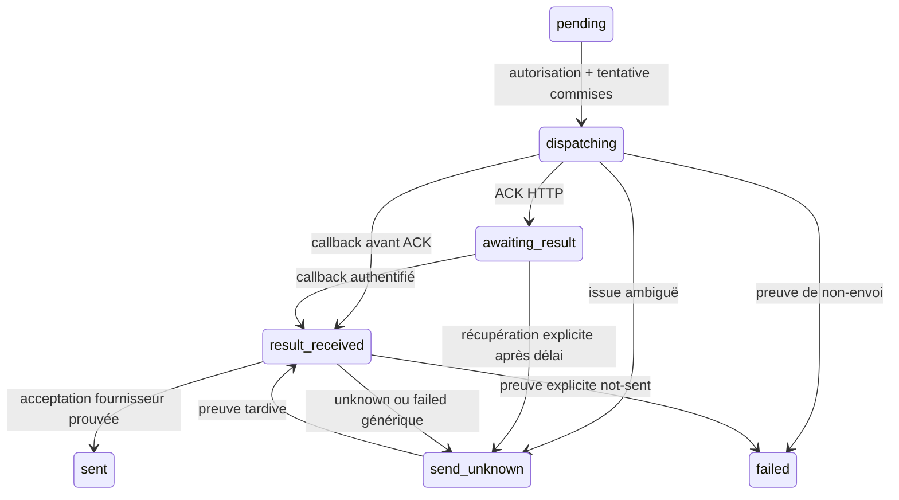

# Phase 9.5.4.1 — Envoi persistant et réconciliation simulée

## Référence et périmètre

Travail local du 21 octobre 2026, sur `main` depuis
`2dab6b4710786d8b437ac6ccc8a730cad3b3c5dd`. HEAD et origin/main concordaient,
arbre propre et index vide au départ. La Phase 9.5.3 et sa CI #67 sont la référence.

**Validation locale terminée : 1 631/1 631 tests dans l'unique suite globale finale,
zéro échec et zéro ignoré.** Les 35 empreintes source sont identiques avant les
passes finales et après leur achèvement. Aucun commit ou push n'est effectué.

Cette tranche utilise exclusivement un fournisseur synthétique en mémoire dans
les tests. Aucun SMTP, Gmail, Outlook, OAuth, fournisseur ou workflow n8n réel
n'est ajouté ou appelé. Le service de production injecte toujours
`UnavailableEmailSendTransport` : aucune option de configuration ne le transforme
en transport réel. Un adaptateur réseau réel reste hors périmètre.

Docker était déjà disponible. Les conteneurs Development PostgreSQL et n8n
étaient arrêtés ; ils ne sont pas démarrés. Toutes les migrations des tests
concernent des bases Testcontainers jetables. Aucune migration Development,
aucun staging, commit ou push ; 9.5.4.2 n'est pas commencée.

## Autorisation et intention unique

`EmailSendDelivery` porte le cycle technique. `EmailSendPlan` reste `approved`,
avec son contenu et sa décision immuables. L'approbation demeure exclusivement
une `AutomationActionRequest` existante ; aucune nouvelle approbation n'est créée.
Le service d'approbation 9.5.3 et `AutomationSafetyPolicy` ne sont pas modifiés.

La prise en charge et le début du dispatch vérifient :

- identité humaine et workspace ; plan et demande exactement approved ;
- auteur de la décision présent et toujours propriétaire autorisé du workspace ;
- type email.send, catégorie email, exigence de décision humaine et snapshot valide ;
- égalité du snapshot canonique complet, du hash du plan et du ContentFingerprint ;
- compte actif, non archivé, From et ConnectionId inchangés ;
- connexion logique du workspace et configuration d'intégration activée et valide ;
- settings persistants actifs, policy autorisant une décision humaine, circuit fermé ;
- références CRM du même workspace ; règle d'origine active, non archivée et
  RuleFingerprint identique lorsqu'il s'agit d'une préparation automation.

Au dispatch, les quotas minute/jour limitent aussi les intentions déjà démarrées
du workspace. Ils comptent les prises en charge techniques, y compris incertaines,
sans fabriquer d'AutomationExecution ni de succès Phase 8.

Une transaction crée l'intention et son IntegrationOperation email.send avant
tout transport. Les contraintes uniques PostgreSQL sur plan, demande, opération
et clé d'idempotence empêchent des intentions concurrentes indépendantes.
Une répétition de prise en charge retourne l'intention existante après contrôle
d'autorisation. La consultation permet de retrouver un commit dont la réponse a été perdue.

La clé `email-send-{DeliveryId}` est déterministe depuis l'identité persistée et
reste inchangée. Un trigger interdit de modifier les identités, le hash, la clé,
le fournisseur ou la date de création, de revenir en pending, ou de modifier
une intention terminale. Les FK composites attachent workspace/compte/connexion,
plan/demande et opération de type email.send.

## Cycle technique et preuve



Les codes stockés utilisent des tirets : `awaiting-result`, `send-unknown`,
`result-received`. Un ACK 202 signifie uniquement que la commande a été reçue.
`sent` signifie **acceptation par le fournisseur**, jamais livraison, lecture ou
réception finale par le destinataire.

La preuve accepted exige un ProviderCode identique au fournisseur de l'intention,
un ExternalMessageId non vide émis par le simulateur et un AcceptedAt UTC cohérent
avec le début de tentative (tolérance future bornée à cinq minutes). Le CRM ne
génère pas cette identité fournisseur. Un résultat `not-sent` exprime une preuve
explicite de non-envoi ; un résultat générique `failed` demeure incertain.
L'adaptateur futur devra établir cette distinction avec des garanties fournisseur
documentées, et ne pas déduire not-sent d'un simple code HTTP.

Le contrat distinct email.send v1 lie message, commande, opération, corrélation,
intention et clé d'idempotence. La commande contient exclusivement le snapshot
approuvé ; le workspace inclus dans ce snapshot est fourni par le CRM. Le résultat
ne choisit aucun workspace : celui-ci et la connexion proviennent de l'authentification
HMAC existante. Les identifiants sont comparés aux lignes persistées avant réception.
Les champs inconnus, doublons JSON, versions, types et identités invalides sont
refusés ; profondeur maximale 6, commande bornée à 65 536 octets à la lecture,
résultat à 4 096 octets. Aucun secret, credential ou URL de callback libre dans le contrat.

## Réconciliation et atomicité

`ReconcileAsync` ne contacte jamais un transport d'envoi. Il consomme les preuves
authentifiées persistées et laisse unknown lorsque celles-ci ne suffisent pas.
Une tentative dispatching ou awaiting-result sans preuve peut être marquée
send-unknown après deux minutes. Cette récupération ne prouve pas qu'un appel
a ou n'a pas eu lieu ; elle couvre un crash avant l'appel comme un crash après.
Aucun retry automatique ni route de remise en pending n'existe.

IntegrationReceipt reçoit `EvidenceNumber`, avec valeur historique par défaut 0.
L'unicité porte sur opération/numéro. Un trigger réserve le slot zéro aux anciens
protocoles et les slots 1 à 100 à email.send. Ainsi les anciens protocoles gardent
une seule réception par opération, tandis qu'une incertitude peut être suivie
d'une preuve tardive, sans écraser la première preuve. MessageId reste globalement
unique et un replay exige le même contenu canonique et son hash.

Le traitement des preuves, leur ProcessedAt, l'état de l'intention, celui de
l'IntegrationOperation et l'EmailMessage outbound sont dans **un seul commit**.
Un échec du commit conserve la preuve non traitée et aucun message n'est créé.
Une seconde réconciliation réussit sans nouvel appel fournisseur. Un ProviderId
déjà lié à un autre message produit un conflit contrôlé, sans deuxième EmailMessage.

Le message confirmé reprend compte, fournisseur, identité retournée, From/To/Cc,
sujet/corps et références CRM du plan, ainsi que la date d'acceptation fournisseur.
Une revalidation des kill switches n'empêche pas d'enregistrer une preuve d'un
envoi déjà autorisé : la réconciliation constate un effet passé, elle n'autorise
aucun nouvel effet. Le hash et le plan approuvé restent vérifiés à la création du message.

## Transactions, verrous et transport

Ordre de prise en charge : workspace SHARE, verrou advisory transactionnel
automation du workspace, demande, compte, settings/règle/références, intention,
opération. Réconciliation : workspace, advisory automation, compte, intention,
opération, preuves et message. Réception/finalisation ne prennent pas de verrou
compte après intention. Les mutations de compte existantes prennent workspace puis compte.

La décision d'autoriser le dispatch est sérialisée avec les changements concurrents
et devient effective au commit de la tentative. Une modification postérieure du
compte ne peut pas rappeler une commande déjà autorisée. Il n'existe aucune garantie
de révocation d'un appel réseau en cours, et aucun verrou PostgreSQL ne reste
détenu pendant le transport.

Le dispatcher partage IntegrationSendGate. Après commit de la tentative, l'appel
utilise un délai indépendant de la requête navigateur ; sa finalisation possède
son propre délai. Une exception est conservatrice et devient unknown. Un callback
ou une réconciliation qui gagne la course ne peut pas être écrasé par l'ACK tardif.
Le fournisseur des tests utilise IntegrationTransport et les signatures HMAC
existantes dans un HttpMessageHandler en mémoire, sans socket ni réseau réel.
Son dictionnaire de preuves par clé d'idempotence simule la consultation fournisseur.

## Routes humaines

| Route | Objet |
| --- | --- |
| POST /api/email-send-deliveries/from-plan/{planId} | Prendre en charge un plan approved |
| GET /api/email-send-deliveries/{id} | Lire l'état et les identités de l'intention |
| POST /api/email-send-deliveries/{id}/dispatch | Dispatch explicite, transport désactivé par défaut |
| POST /api/email-send-deliveries/{id}/reconcile | Traiter les preuves ou récupérer l'incertitude |

Cookie humain et antiforgery sur les mutations. Aucun corps d'email client n'est
utilisé par ces routes. Les callbacks passent par `/api/integrations/results`,
réservé à HMAC avec les contrôles existants de signature, connexion et workspace.

## Migration et validations

Migration nouvelle : `20261021075256_Phase9541EmailSendDeliveries`.
Table EmailSendDeliveries, contraintes/index/FK/triggers, type d'opération email.send,
slots de preuves et clé alternative du plan. Aucune migration historique réécrite.
Down refuse transactionnellement toute intention ou opération email.send existante,
pour ne perdre aucune preuve ; Down/Up est permis lorsque ce périmètre est vide.
Le test d'upgrade conserve toutes les lignes des tables antérieures, dont un plan
approved et sa décision ; seule la colonne ajoutée EvidenceNumber est exclue de
la comparaison des schémas antérieurs.

| Contrôle | Résultat |
| --- | --- |
| Build Release final | 0 erreur, 0 avertissement (`build-05`) |
| Tests dédiés | 36/36, 0 échec, 0 ignoré (`dedicated-final`, 27 s) |
| Vérification des corrections et dédiés sur binaires finaux | 39/39, 0 échec, 0 ignoré (`corrections-01`, 32 s) |
| Régressions ciblées | 921/921, 0 échec, 0 ignoré (`regressions-final`, 6 min 18 s) |
| Suite globale finale | **1 631/1 631**, 0 échec, 0 ignoré (`global-final`, 21 min 57 s) |
| HasPendingModelChanges | false, commande EF et tests de migration |
| Empreintes source finales | **35/35 identiques**, aucune différence de périmètre |
| git diff --check | Réussi à la clôture, code 0 |
| Index Git | Vide |

Preuves privées hors Git :
`%LOCALAPPDATA%\ProspectionCrmOperations\phase-9-5-4-1-20261021`.
La première compilation a signalé les deux CS8618 historiques de Settings.razor.
La compilation des premiers tests a signalé deux xUnit2031, corrigés en utilisant
l'overload Assert.Single avec prédicat. Le build final est sans avertissement.

Historique rouge conservé : `dedicated-01` = **29/31**, deux échecs. Le scénario
d'identité invalide tentait de mettre DecidedByUserId à null, déjà interdit par
CK_ActionRequests_Decision ; il utilise désormais un utilisateur existant mais
non autorisé. Le test d'absence de transaction pendant HTTP prenait intention puis
compte, inversant l'ordre concurrent ; il prend désormais compte puis intention.
`dedicated-02` = **34/34**, puis **36/36** après ajout du test de règle d'origine
et de corrélation et renforcement du test de préservation de migration.

La première régression (`regressions-01`) termine à **918/921**, trois échecs,
zéro ignoré, en 6 min 19 s. Deux reconstructions historiques utilisaient la lecture
des reçus de probe sur un schéma antérieur à EvidenceNumber : la projection du
probe est limitée à ses champs historiques. Le troisième échec vérifiait le code
FK 23503 pour une opération absente ; le trigger de slot rend désormais la main
à cette FK lorsque l'opération n'existe pas, au lieu de masquer son erreur par
une check violation 23514. Les assertions historiques sont conservées.
La passe `corrections-01` vérifie les trois scénarios corrigés et les 36 tests
dédiés sur `build-05` : **39/39**, zéro échec et zéro ignoré.
La régression finale corrigée passe ensuite à **921/921**, zéro échec et zéro ignoré,
en 6 min 18 s. Aucune assertion historique de préservation n'est supprimée.

Les 35 fichiers source du périmètre sont inventoriés en SHA-256 dans
`final-source-hashes.json`, hors dépôt. La régression corrigée et la suite globale
utilisent les mêmes binaires Release, sans build ni restore. Les empreintes sont
contrôlées avant la suite globale et à la clôture.

La suite globale unique termine proprement : `ResultSummary.outcome=Completed`,
1 631 résultats individuels, tous réussis ; zéro erreur, timeout, abandon ou test
non exécuté. Début TRX : `2026-10-21T10:12:14.1867197+02:00` ; fin :
`2026-10-21T10:34:13.0695086+02:00` (Europe/Paris). Le journal affiche 21 min 57 s
pour les tests ; l'intervalle du run TRX inclut aussi son initialisation/finalisation.
Aucune seconde suite globale n'a été nécessaire.

Les commandes de test utilisent `dotnet test ProspectionCrm.slnx --configuration
Release --no-build --no-restore`, avec journaux et TRX distincts hors dépôt.
Sélection dédiée : `FullyQualifiedName~EmailSendDelivery`. Sélection de régression :
`FullyQualifiedName~Automation|FullyQualifiedName~EmailSync|FullyQualifiedName~EmailAccount|FullyQualifiedName~EmailSendPlan|FullyQualifiedName~Integration|FullyQualifiedName~RemoteCollection|FullyQualifiedName~Migration`.
La passe globale n'utilise aucun filtre.

À la clôture, PostgreSQL Development et n8n sont toujours `exited`, avec leurs
StartedAt inchangés du 16 octobre (11:06:34Z et 11:12:54Z respectivement) et un
RestartCount de 0. Aucun listener sur 5432/5678/5016/5054/7075/7096/7443, aucun
processus API/Blazor/proxy. Aucune lecture ou migration SQL de Development n'a
été requise. HEAD, origin/main et la référence distante vérifiée restent au SHA
de départ ; aucune donnée Development, aucun secret réel, journal, TRX, dump ou
artefact de test ne figure dans l'inventaire Git.

Les cas dédiés couvrent contrats stricts, autorisation, unicité concurrente,
ACK sans message, succès et replay, timeout/déconnexion/HTTP failed, échec certain,
preuves unknown puis tardives, callback avant ACK, callbacks concurrents, absence
de transaction pendant transport, crash avant/après appel, conflit ProviderId,
échec différé du commit CRM, cookie/CSRF/HMAC et migrations.

## Limites et validation réelle future 9.5.4.2

Exactly-once externe n'est pas supposé. La tranche garantit une seule intention
et une seule tentative autorisée ; elle conserve les issues ambiguës sans renvoi.
La qualité d'une preuve accepted/not-sent dépend de l'adaptateur fournisseur
authentifié. Le simulateur ne démontre aucune garantie d'un fournisseur réel.

Pour 9.5.4.2 uniquement : choisir et documenter un fournisseur avec son contrat
d'idempotence et de recherche, implémenter l'adaptateur sécurisé explicitement
configuré, vérifier les preuves d'acceptation/non-envoi et les callbacks tardifs,
puis préparer une validation réelle autorisée, avec sauvegarde et migration
Development décidées séparément. Aucune de ces actions n'est exécutée ici.

## Inventaire Git

36 fichiers : 24 modifiés et 12 nouveaux, dont ce rapport. Index vide.
Aucun commit ou push ; HEAD et origin/main restent sur
`2dab6b4710786d8b437ac6ccc8a730cad3b3c5dd`.

```text
 M src/ProspectionCrm.Api/Data/Configurations/IntegrationConfiguration.cs
 M src/ProspectionCrm.Api/Data/Migrations/ProspectionCrmDbContextModelSnapshot.cs
 M src/ProspectionCrm.Api/Data/ProspectionCrmDbContext.cs
 M src/ProspectionCrm.Api/Entities/IntegrationReceipt.cs
 M src/ProspectionCrm.Api/Program.cs
 M src/ProspectionCrm.Api/Services/Integrations/IntegrationStore.cs
 M tests/ProspectionCrm.Api.Tests/AutomationActionRequestMigrationTests.cs
 M tests/ProspectionCrm.Api.Tests/AutomationCircuitMigrationTests.cs
 M tests/ProspectionCrm.Api.Tests/AutomationEventDispatcherTests.cs
 M tests/ProspectionCrm.Api.Tests/AutomationJobMigrationTests.cs
 M tests/ProspectionCrm.Api.Tests/AutomationRuntimeMigrationTests.cs
 M tests/ProspectionCrm.Api.Tests/EmailSendPlanMigrationTests.cs
 M tests/ProspectionCrm.Api.Tests/EmailSyncMigrationTests.cs
 M tests/ProspectionCrm.Api.Tests/IngestionHistoryReadTests.cs
 M tests/ProspectionCrm.Api.Tests/IngestionHistoryTests.cs
 M tests/ProspectionCrm.Api.Tests/IntegrationPersistenceMigrationTests.cs
 M tests/ProspectionCrm.Api.Tests/IntegrationSecurityMigrationTests.cs
 M tests/ProspectionCrm.Api.Tests/Phase6ReconstructionTests.cs
 M tests/ProspectionCrm.Api.Tests/RemoteCollectionMigrationTests.cs
 M tests/ProspectionCrm.Api.Tests/RemoteCollectionResultProcessingTests.cs
 M tests/ProspectionCrm.Api.Tests/RssCollectionTests.cs
 M tests/ProspectionCrm.Api.Tests/SecurityTestHost.cs
 M tests/ProspectionCrm.Api.Tests/SourceCollectionJobMigrationTests.cs
 M tests/ProspectionCrm.Api.Tests/SourceCollectionSchedulingMigrationTests.cs
?? docs/phase-9-5-step-4-1-validation.md
?? src/ProspectionCrm.Api/Controllers/EmailSendDeliveriesController.cs
?? src/ProspectionCrm.Api/Data/Configurations/EmailSendDeliveryConfiguration.cs
?? src/ProspectionCrm.Api/Data/Migrations/20261021075256_Phase9541EmailSendDeliveries.Designer.cs
?? src/ProspectionCrm.Api/Data/Migrations/20261021075256_Phase9541EmailSendDeliveries.cs
?? src/ProspectionCrm.Api/Dtos/Integrations/EmailSendContracts.cs
?? src/ProspectionCrm.Api/Entities/EmailSendDelivery.cs
?? src/ProspectionCrm.Api/Services/Email/EmailSendDeliveryService.cs
?? src/ProspectionCrm.Api/Services/Email/EmailSendDispatcher.cs
?? tests/ProspectionCrm.Api.Tests/EmailSendDeliveryContractTests.cs
?? tests/ProspectionCrm.Api.Tests/EmailSendDeliveryMigrationTests.cs
?? tests/ProspectionCrm.Api.Tests/EmailSendDeliveryTests.cs
```
